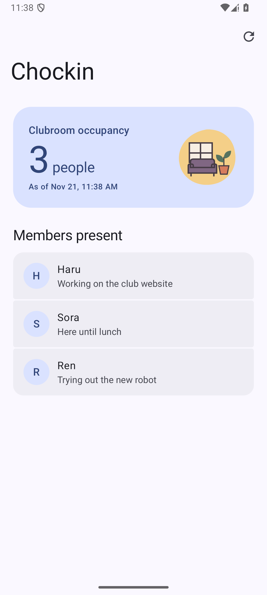
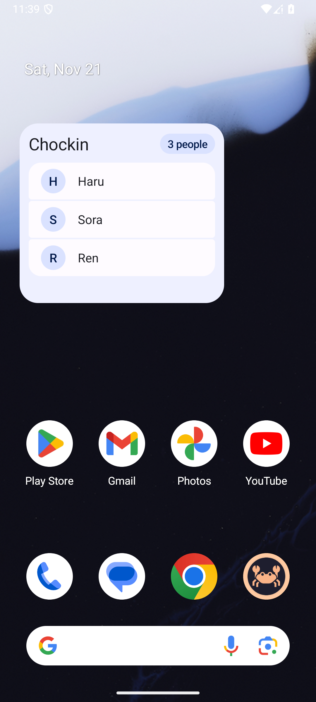

# Chockin Widget

See who is in the clubroom from your Android home screen. The widget shows each member’s name and profile picture. Tap it to open the app and read their status messages.

| App | Home screen widget |
| --- | --- |
|  |  |

The screenshots use sample members.

## Install

Chockin Widget runs on Android 13 or later and supports English and Japanese.

For a release with an APK, open **Assets** and install the `chockin-widget-*.apk` file. [GitHub Releases](https://github.com/gongitsune/chockin-widget/releases)

You can also build the app yourself. Open the `app/` folder in Android Studio, select your phone or emulator, and click **Run**.

## Add the widget

1. Touch and hold an empty spot on your home screen.
2. Open **Widgets** and find **Chockin Widget**.
3. Drag **Clubroom occupancy** onto your home screen.

The widget checks for updates about every 30 minutes. To check sooner, tap the widget to open the app, then pull down on the list or tap the refresh button.
